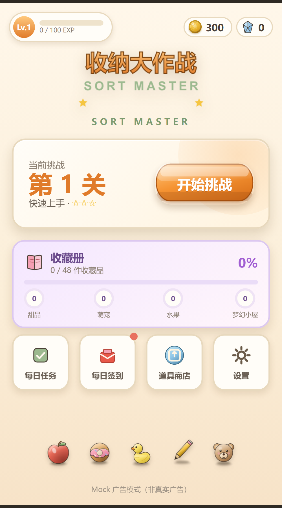
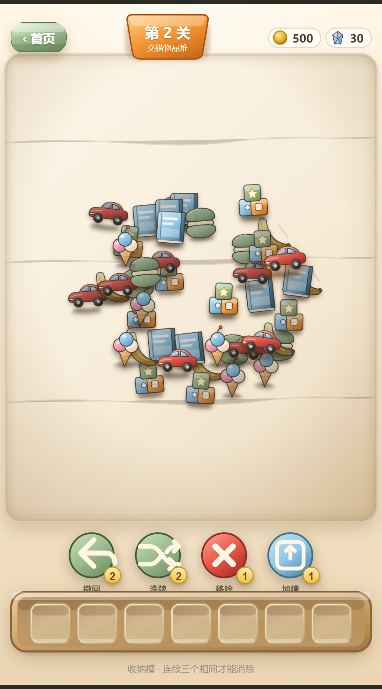

# 收纳大作战（Sort Master）

高品质 2D 休闲消除 + 高难度闯关 + 收藏品收集，基于 **Cocos Creator 3.8.x + TypeScript**，目标平台微信小游戏。

> **Unity 2D 重制版**：见 [`UnityProject/`](UnityProject/README.md)，交付状态与未完成项见 [`docs/UNITY_DELIVERY.md`](docs/UNITY_DELIVERY.md)。
> 当前本机未安装 Unity，Unity 版尚未编译与构建；线上仍为下方 Web/Cocos 版本。

**核心循环**：挑战关卡 → 通关开宝箱 → 获得收藏品 → 完成系列 → 解锁主题 → 挑战更高难度。





## 视觉规范（2.5D 玩具插画）

- **物品素材**：30 件统一 2.5D 风格（`tools/gen-art2.mjs` 生成）——3/4 俯视、左上主光、
  体积渐变（亮部/固有色/暗部三段）、左上轮廓光、镜面高光、接触阴影 + 环境投影、材质纹理（颗粒/条纹/纸页）。
  汽车有烤漆高光与轮胎厚度、香蕉有果皮纹理与自然弧度、书本有书脊厚度与纸页层次、冰淇淋有奶油质感与甜筒纹路。
- **堆叠表现**：每个物品确定性微旋转（±7.4°）+ 独立接触阴影；被遮挡物品**不做整体置灰**，
  而是降低亮度/饱和度并依赖上层投影呈现真实遮挡；解锁时亮度平滑恢复。
- **场景容器**：棋盘为独立圆角桌面容器（`table.png` 木纹 + 内阴影 + 边缘高光），
  与顶栏徽章、收纳托盘、道具栏形成明确层级。
- **收纳槽**：立体凹槽素材（`slot_cell.png`）+ 木质托盘（`tray.png`），入槽有落位弹跳。
- **UI**：3D 立体按钮（正常/按下/禁用态）、关卡徽章、立体金币与碎片宝石、圆形道具图标 + 数量徽章。

## 核心规则（连续匹配，非全局计数）

点击物品进入底部 7 格收纳槽，**只有三个完全相同的物品在槽内连续相邻**才消除：

- `A A A` → 消除；`A B A` / `A B A A` / `A A B A` → 不消除
- `A B B B A` → 只消除中间三个 B；`A A A B B B` → 两组分别消除
- 消除后向左补位；**不做"同类总数≥3 就消除"的判定**

遮挡采用 **z 序**（层号大在上；同层数组靠后在上），逻辑遮挡与视觉遮挡严格等价（实测 0 命中偏差）。

## 收藏系统（48 件）

| 系列 | 数量 | 稀有度分布 |
|---|---|---|
| 甜品系列 | 12 | 6 普通 / 3 稀有 / 2 史诗 / 1 传说 |
| 萌宠系列 | 12 | 同上 |
| 水果系列 | 12 | 同上 |
| 梦幻小屋系列 | 12 | 同上 |

- **首次通关必定获得一件收藏品**（确定性算法，非随机）
- 里程碑关卡（5/10/15/20/30/40/50/60/75/90/100）必定获得指定传说/史诗收藏品
- 可获得的稀有度随关卡进度放开（稀有 6 关起 / 史诗 16 关起 / 传说 31 关起）
- 重复获得自动转为收藏碎片；碎片可兑换未拥有的收藏品
- 集齐一个系列解锁专属主题（糖霜/暖绒/果园/星灯），首页背景切换
- 收藏册：4 系列 × 12 件，已收集显示图片与获得时间，未收集显示剪影，可点击查看详情

## 成长与任务

玩家等级（EXP 升级奖励）、通关星级（1~3★）、每日任务（4 项，事件驱动）、每日签到（7 天循环）、连续通关奖励、里程碑奖励。

## 关卡布局：中央集中式物品堆

- 每关所有物品集中在一个主堆（半径 150~255px），堆中心对齐棋盘中心（实测偏移 ≤1.5%）。
- 5~7 个深度层，中间层最厚、上下层递减；每层有随机中心偏移与旋转，上层半径收窄，
  形成"中间高、边缘低"的错位堆叠，下层边缘自然露出。
- 同层最小中心距 27~58px（按难度递增而变小），物品大量交叠；少量物品外溢到堆边缘。
- 受控随机而非完全随机：生成后做**密度自适应**（完全不可见比例 ≤45%、平均可见率 ≥15%），
  不达标则自动扩堆/加间距/减层重建，并做包围盒居中校正与安全区裁剪。
- 遮挡关系由**几何 + z 序**在运行时推导（层号大在上、同层数组靠后在上），
  关卡 JSON 只存校验摘要（`occlusion.edgeCount`），避免集中堆叠导致包体膨胀（单关 2~19KB）。

## 关卡（100 关，构造式保证可解）

| 关卡 | 物品 | 类型 | 层 | 障碍 | 遮挡边 |
|---|---|---|---|---|---|
| 1 | 12 | 3 | 2 | - | 8 | 353×335 |
| 2 | 45 | 6 | 4 | - | 94 | 531×468 |
| 3 | 54 | 7 | 5 | - | 126 | 540×512 |
| 5 | 75 | 9 | 5 | 冰冻×2 | 270 | 580×507 |
| 10 | 90 | 10 | 6 | 冰冻3 锁定1 | 282 | 584×550 |
| 25 | 111 | 11 | 6 | 冰冻5 锁定2 | 305 | 568×528 |
| 60 | 147 | 11 | 5 | 冰冻6 锁定3 | 441 | 577×518 |
| 100 | 150 | 12 | 6 | 冰冻6 锁定2 | 411 | 570×562 |

（表列：关卡 / 物品 / 类型 / 层数 / 障碍 / 遮挡边数 / 物品堆包围盒）

生成方式：几何布局 → 求合法剥离顺序 → 沿顺序用安全连续匹配模式分配类型 → **回放验证** → 解法序列写入关卡 JSON。自动化测试用 `GameSession` 逐关回放该序列（100/100 通关）。

## 运行

```bash
# 浏览器可玩预览（无需 Cocos）
node tools/serve.mjs 8377
# http://localhost:8377/playable-preview/index.html

# 测试
npm install
npx tsc -p tsconfig.node.json
node build/tests/run.js            # 85 项

# 真实浏览器验收
node tools/browser-verify-visual.mjs    # 视觉 12 项 + 6 张细节/动画截图
node tools/browser-verify-product.mjs   # 产品链路 19 项 + 截图
node tools/browser-verify.mjs           # 玩法 10 项

# 素材重建（2.5D）
cd tools && node gen-art2.mjs           # 30 物品 + 立体 UI（托盘/槽位/按钮/宝箱）
node gen-collectibles.mjs               # 48 收藏品
node gen-audio.mjs                      # 音效
node gen-levels.cjs                     # 100 关（构造式可解）
```

## 目录

```
assets/scripts/
  collection/        CollectionData（48 件）/ CollectionManager（发奖·碎片·系列）
  systems/progress/  ProgressManager（等级 / 每日任务 / 里程碑）
  gameplay/logic/    MatchManager / 遮挡(z序) / 槽位 / 状态机 / 求解器（纯逻辑）
  ui/                ChestUI（开箱流程）/ DailyTaskUI / 商店 / 设置 / 收藏详情
  scenes/            Loading / Home / Game / Collection 场景控制器
assets/resources/
  textures/collect/  48 件收藏品原创素材
  textures/ui/       宝箱、稀有度框、碎片、任务图标等
  data/levels/       100 个关卡（含 solutionValidation.solution 解法序列）
tools/               素材生成 / 关卡生成 / 浏览器验收
docs/                DEVELOPMENT / WECHAT_PUBLISH / TEST_REPORT
```

## 存档

`schemaVersion: 2`，键名沿用 `sort_master_save_v1` 以兼容旧档：v1→v2 自动迁移（旧关卡/金币/道具/设置完整保留），checksum 在迁移前校验，损坏回退默认档可启动。

## 商业化

微信激励视频（复活 / 额外金币 / 道具）为真实实现 + Mock 降级；**正常通关与收藏奖励不依赖广告**。配置入口见 `docs/WECHAT_PUBLISH.md`。
